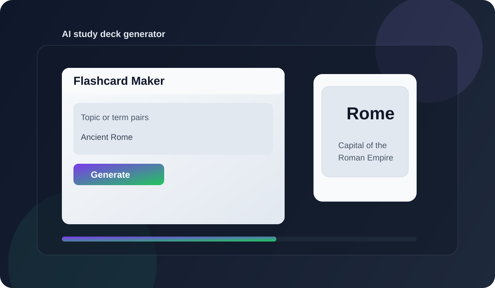

# Flashcard Maker

Effortless flashcards on any subject. Just name a topic, and the app generates a study deck using Gemini.

## Live preview

Local deployment preview:
- http://localhost:3000

Production deployment link:
- Add your hosted URL here after deploying to Render, Railway, Vercel, or another Node hosting platform.

## Project image



## Features

- Generate flashcards from a topic or term/definition list
- Uses the Gemini API to produce study cards in a simple UI
- Elegant flip-card interaction for quick review
- Works with a Node + Express backend and Vite frontend

## Tech stack

- TypeScript
- Vite
- Express
- Google Gemini API
- CSS and HTML

## Getting started

1. Install dependencies:
   ```bash
   npm install
   ```

2. Set your Gemini API key:
   ```bash
   export GEMINI_API_KEY="your_api_key_here"
   ```
   or in Windows PowerShell:
   ```powershell
   $env:GEMINI_API_KEY="your_api_key_here"
   ```

3. Start the app in development mode:
   ```bash
   npm run dev
   ```

4. Open the app:
   ```bash
   http://localhost:3000
   ```

## Production build

```bash
npm run build
npm run start
```

## Deployment

This project is ready to deploy on a Node-compatible hosting service. For example:

- Render
- Railway
- Fly.io
- Azure App Service
- VPS / Docker host

Set the environment variable `GEMINI_API_KEY` on the hosting platform before deployment.

## Project structure

```text
.
├── index.html
├── index.css
├── index.ts
├── server.ts
├── genaiProxy.ts
├── package.json
├── tsconfig.json
├── vite.config.ts
├── metadata.json
└── assets/
    └── flashcard-maker-preview.svg
```

## Notes

The app expects a Gemini API key on the server. Without that key, the flashcard generation routes will fail until the environment variable is configured.
